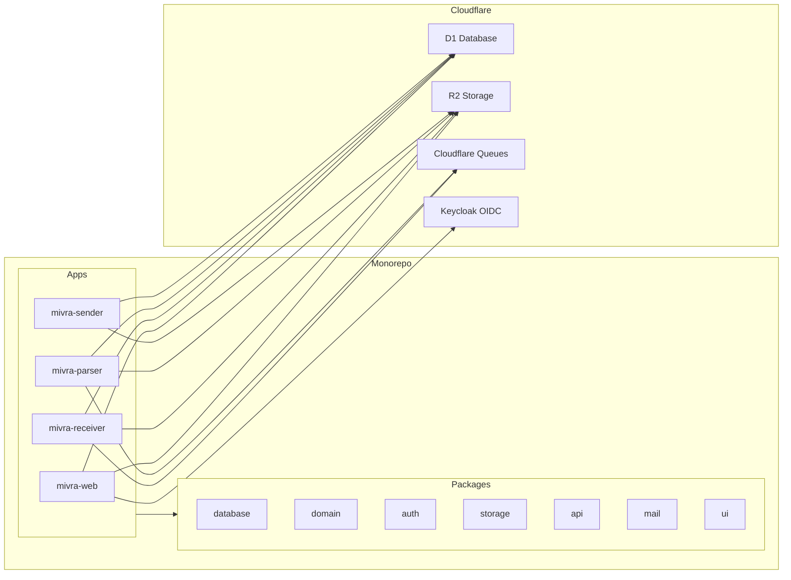

# Requirements

### 概要 & 目的
Mivra のモノレポを構築し、Cloudflare を中心とした Web メールプラットフォームの Phase 1（基盤構築レイヤー）を実装します。これには、プロジェクト構成、共有パッケージ、D1 スキーマ定義、各 Worker のスケルトン、および CI/CD パイプラインのセットアップが含まれます。

### ゴール
- `apps/` および `packages/` ディレクトリを含む pnpm モノレポ構成を確立する。
- 各サービス用の Cloudflare Workers（Wrangler）設定を定義する。
- システム全体設計に基づく全 12 テーブルの D1 スキーマを定義・マイグレーション化する。
- データベースアクセス、ドメイン型定義、認証、ストレージ、API ユーティリティの共有パッケージを作成する。
- GitHub Actions を用いた CI/CD（Lint、型チェック、テスト、Wrangler デプロイ）を構築する。
- Keycloak OIDC 認証連携の基盤を実装する（Keycloak は稼働中と想定）。

### スコープ

**Phase 1 対象範囲 (In Scope):**
- モノレポ基盤の構築（`pnpm-workspace.yaml`、ルート設定）
- TypeScript、ESLint、Vitest の設定
- 全 12 テーブルを含む D1 スキーマとマイグレーションファイル
- Worker スケルトン: `mivra-web`, `mivra-receiver`, `mivra-parser`, `mivra-sender`
- 共有パッケージ: `database`, `domain`, `auth`, `storage`, `api`, `mail`, `ui` (スケルトン)
- 各 Worker の Wrangler 設定（Bindings、Secrets、環境別設定）
- GitHub Actions ワークフロー（Lint → Typecheck → Test → Deploy）
- Keycloak OIDC 認証モジュール（`packages/auth`）
- R2 バケット設定
- Cloudflare Queues 設定（受信キュー、送信キュー）

**対象外（以降のフェーズで対応）(Out of Scope):**
- メール受信・振り分けロジックの実装（Phase 2）
- MIME 本文・添付ファイル解析の詳細実装（Phase 2）
- Amazon SES 送信ロジックの実装（Phase 3）
- Web UI (SPA) の画面実装（Phase 2 以降）
- SES イベント受信 Worker の実装（Phase 4 以降）
- 管理画面 Worker の実装（Phase 4 以降）
- メンテナス Worker の実装（Phase 4 以降）
- Terraform によるインフラ完全自動化（Phase 4 以降）

# Technical Design

### 現状 (Current State)
リポジトリ `/home/kigawa/dev/kigawa-net/mivra` は新規作成された状態（コミットなし）です。コード、設定ファイル、ディレクトリ構造はまだ存在しません。

### 主要な設計判断 (Key Decisions)

1. **pnpm ワークスペースによるモノレポ構成**
   すべてのアプリおよびパッケージを `pnpm-workspace.yaml` 配下で一元管理します。共通コードは `packages/` 内の内部パッケージとして参照します。

2. **Worker ごとの Wrangler 構成**
   各アプリ（`web`, `receiver`, `parser`, `sender`）に個別の `wrangler.toml` を配置し、環境別（development, staging, production）の Bindings（D1, R2, Queues, Secrets）を定義します。

3. **Wrangler による D1 マイグレーション管理**
   `migrations/` 配下に SQL マイグレーションファイルを配置し、`wrangler d1 execute` で適用します。外部マイグレーションツールへの過度な依存を排除します。

4. **UUIDv7 の内部識別子採用**
   時系列ソートが可能でインデックス効率の高い UUIDv7 を全内部エンティティの ID に採用し、`packages/domain` で生成ユーティリティを提供します。

5. **`packages/auth` による Keycloak OIDC 統合**
   OIDC ディスカバリ、トークン検証、暗号化セッション Cookie 管理を共通パッケージとして集約し、各 Worker から利用します。

6. **3 階層の環境分離**
   `development`、`staging`、`production` の 3 環境を Wrangler の環境設定および GitHub Actions ワークフローで分離管理します。

### 変更内容 (Proposed Changes)

#### ルート設定 (Root Configuration)
- `pnpm-workspace.yaml` — `apps/*` および `packages/*` のワークスペース定義
- `package.json` — ルートスクリプト（lint, test, typecheck, build）
- `tsconfig.json` — 共通 TypeScript 基本設定
- `.eslintrc.js` — 共通 ESLint 設定
- `.gitignore` — node_modules, dist, .wrangler, シークレット等
- `README.md` — プロジェクト概要と開発ガイド

#### アプリケーション (Worker Skeletons)

- **`apps/web/` (`mivra-web`)**
  - `wrangler.toml` — Static Assets + Web API 用 Bindings (D1, R2, Session Secrets)
  - `src/index.ts` — HTTP リクエストハンドラ（SPA 配信 + `/api/v1/*` ルーティング）
  - `src/routes.ts` — API ルート定義（スタブハンドラ）
  - `src/middleware/auth.ts` — セッション認証ミドルウェア

- **`apps/receiver/` (`mivra-receiver`)**
  - `wrangler.toml` — Email Trigger, D1, R2, Receive Queue 用 Bindings
  - `src/index.ts` — Email ハンドラスケルトン（宛先確認、原文 R2 保存、キュー投入）

- **`apps/parser/` (`mivra-parser`)**
  - `wrangler.toml` — Queue Consumer, D1, R2 用 Bindings
  - `src/index.ts` — キューハンドラスケルトン（MIME 解析、本文・添付抽出）

- **`apps/sender/` (`mivra-sender`)**
  - `wrangler.toml` — Queue Consumer, D1, R2 用 Bindings, SES シークレット
  - `src/index.ts` — キューハンドラスケルトン（Amazon SES API v2 送信）

#### 共有パッケージ (Shared Packages)

- **`packages/database/`** (D1 アクセス層)
  - `src/schema.ts` — 全 12 テーブルの TypeScript 型定義
  - `src/queries.ts` — パラメータ化クエリビルダ
  - `src/migrations/001_initial.sql` — 初期 D1 スキーマ定義

- **`packages/domain/`** (ドメイン型・共通ユーティリティ)
  - `src/types.ts` — Tenant, User, Mailbox, Message, SendJob 等のドメイン型
  - `src/uuid.ts` — UUIDv7 生成ユーティリティ
  - `src/errors.ts` — 統一エラー型定義

- **`packages/auth/`** (OIDC 認証)
  - `src/oidc.ts` — Keycloak OIDC クライアント（ディスカバリ、トークン検証）
  - `src/session.ts` — セッション Cookie の署名・暗号化・検証
  - `src/roles.ts` — ロール定義と認可チェックロジック

- **`packages/storage/`** (R2 操作)
  - `src/keys.ts` — R2 オブジェクトキー生成（`tenants/{id}/messages/{id}/raw.eml` 等）
  - `src/upload.ts` — アップロードユーティリティ
  - `src/download.ts` — ダウンロードユーティリティ

- **`packages/api/`** (HTTP API ユーティリティ)
  - `src/response.ts` — JSON レスポンスヘルパー
  - `src/pagination.ts` — カーソルページネーションユーティリティ
  - `src/errors.ts` — 統一エラーレスポンスフォーマット

- **`packages/mail/`** (メール共通処理)
  - `src/address.ts` — メールアドレス検証・パース
  - `src/message-id.ts` — Message-ID 生成ユーティリティ

- **`packages/ui/`** (共通 UI コンポーネント)
  - `src/index.ts` — Phase 2+ 用のプレースホルダー

#### CI/CD
- `.github/workflows/ci.yml` — PR 作成時の Lint、型チェック、テスト実行
- `.github/workflows/deploy.yml` — main (production) / develop (staging) マージ時の Cloudflare デプロイ

#### ドキュメント & インフラ定義
- `migrations/001_initial.sql` — 全 12 テーブル、インデックス、外部キーの初期 D1 スキーマ
- `infrastructure/cloudflare/` — Wrangler 環境設定
- `docs/architecture/README.md` — システム全体設計ドキュメントの参照
- `docs/api/README.md` — API 仕様ドキュメントのプレースホルダー
- `docs/operations/README.md` — 運用ガイドのプレースホルダー

### ファイル構成 (File Structure)

```
kigawa-net/mivra/
├── pnpm-workspace.yaml
├── package.json
├── tsconfig.json
├── .eslintrc.js
├── .gitignore
├── README.md
├── apps/
│   ├── web/
│   │   ├── wrangler.toml
│   │   ├── package.json
│   │   └── src/
│   │       ├── index.ts
│   │       ├── routes.ts
│   │       └── middleware/
│   │           └── auth.ts
│   ├── receiver/
│   │   ├── wrangler.toml
│   │   ├── package.json
│   │   └── src/
│   │       └── index.ts
│   ├── parser/
│   │   ├── wrangler.toml
│   │   ├── package.json
│   │   └── src/
│   │       └── index.ts
│   └── sender/
│       ├── wrangler.toml
│       ├── package.json
│       └── src/
│           └── index.ts
├── packages/
│   ├── database/
│   │   ├── package.json
│   │   └── src/
│   │       ├── schema.ts
│   │       ├── queries.ts
│   │       └── migrations/
│   │           └── 001_initial.sql
│   ├── domain/
│   │   ├── package.json
│   │   └── src/
│   │       ├── types.ts
│   │       ├── uuid.ts
│   │       └── errors.ts
│   ├── auth/
│   │   ├── package.json
│   │   └── src/
│   │       ├── oidc.ts
│   │       ├── session.ts
│   │       └── roles.ts
│   ├── storage/
│   │   ├── package.json
│   │   └── src/
│   │       ├── keys.ts
│   │       ├── upload.ts
│   │       └── download.ts
│   ├── api/
│   │   ├── package.json
│   │   └── src/
│   │       ├── response.ts
│   │       ├── pagination.ts
│   │       └── errors.ts
│   ├── mail/
│   │   ├── package.json
│   │   └── src/
│   │       ├── address.ts
│   │       └── message-id.ts
│   └── ui/
│       ├── package.json
│       └── src/
│           └── index.ts
├── migrations/
│   └── 001_initial.sql
├── infrastructure/
│   ├── terraform/
│   └── cloudflare/
├── docs/
│   ├── architecture/
│   │   └── README.md
│   ├── api/
│   │   └── README.md
│   └── operations/
│       └── README.md
├── .github/
│   └── workflows/
│       ├── ci.yml
│       └── deploy.yml
└── vitest.config.ts
```

### アーキテクチャ図 (Architecture Diagram)



### リスクと対策 (Risks)
- **D1 Binding の制約**: Worker からの D1 参照は Binding 経由で行われます。動的なテナント別 DB 切り替えは Phase 1 では行わず、単一 D1（`tenant_id` による論理分離）で確実に運用できるようにします。
- **Wrangler 環境とシークレット管理**: 環境ごとの Secrets や Bindings は CI/CD デプロイ時に適切に注入・設定される必要があります。
- **Keycloak の接続前提**: 開発・テスト時にローカルまたは検証用 Keycloak エンドポイントが利用可能である前提とします。

# Testing

### 検証方針 (Validation Approach)
スキャフォールディング後、以下の検証を実施します:
1. `pnpm install` がエラーなく成功すること
2. `pnpm build` および `pnpm typecheck` で全パッケージおよびアプリの型チェック・ビルドが成功すること
3. `pnpm lint` がパスすること
4. `pnpm test` で各パッケージの初期単体テストがパスすること
5. `wrangler dev` により各 Worker がローカル環境で起動確認できること

### 主要シナリオ (Key Scenarios)
- **モノレポ依存解決**: ワークスペースプロトコル経由で `apps/*` から `packages/*` の関数や型定義が正しくインポートできること。
- **D1 スキーマ整合性**: `migrations/001_initial.sql` が正しく D1 に適用でき、全 12 テーブルの外部キー・インデックスが有効であること。
- **Wrangler 設定**: 各 `wrangler.toml` が必要な Bindings（D1, R2, Queues, Secrets）を過不足なく定義していること。
- **CI/CD パイプライン**: GitHub Actions ワークフローで PR 時の検証ステップが定義されていること。

### エッジケース (Edge Cases)
- **必須シークレット未設定時の挙動**: 開発モードでシークレットが未定義の場合でも適切なエラーメッセージを出力すること。
- **初期空データベース**: レコードが 0 件の状態でも API エンドポイントやクエリビルダが正常に空配列/適切なハンドリングを行うこと。
- **循環依存の防止**: パッケージ間の循環参照が発生していないこと。

# Delivery Steps

### ✓ Step 1: モノレポ構成とルート設定の構築
pnpm ワークスペース、TypeScript、ESLint、Vitest の設定を含むプロジェクト基盤を構築します。

- `pnpm-workspace.yaml` を作成し、`apps/*` および `packages/*` をワークスペースとして定義。
- ルート `package.json` を作成し、一括実行用スクリプト（lint, test, typecheck, build）を設定。
- 厳格な TypeScript ルールを適用したルート `tsconfig.json` を作成。
- 共通の `.eslintrc.js` および `.gitignore` を設定。
- テスト実行用の `vitest.config.ts` を作成。
- プロジェクト概要を記載した `README.md` を作成。
- `pnpm install` を実行し、ワークスペースの依存関係解決を確認。

### ✓ Step 2: 共有パッケージの実装（ドメイン型・共通ユーティリティ）
全 Worker が依存する 7 つの共有パッケージを実装します。

- **`packages/domain`**: UUIDv7 生成関数、主要ドメイン型（Tenant, User, Mailbox, Message, SendJob）、エラー型。
- **`packages/database`**: D1 スキーマ型定義、クエリビルダ、全 12 テーブルを含む `001_initial.sql`。
- **`packages/auth`**: Keycloak OIDC クライアント、セッション Cookie 管理、ロール定義・認可関数。
- **`packages/storage`**: R2 オブジェクトキー生成、アップロード/ダウンロードヘルパー。
- **`packages/api`**: JSON レスポンスヘルパー、カーソルページネーション、統一エラーフォーマッタ。
- **`packages/mail`**: メールアドレスパース・検証、Message-ID 生成。
- **`packages/ui`**: 将来の React コンポーネント用のプレースホルダー。
- 各パッケージの `package.json` および `tsconfig.json` を適切に設定。

### ✓ Step 3: Worker スケルトンの作成と Wrangler 設定
4 つの MVP Worker（web, receiver, parser, sender）の Wrangler 設定とハンドラースケルトンを作成します。

- **`apps/web`**: Static Assets + API Bindings を含む `wrangler.toml`、HTTP ハンドラ、API ルート定義、認証ミドルウェア。
- **`apps/receiver`**: Email Trigger, D1, R2, Queue Bindings を含む `wrangler.toml`、メール受信ハンドラースケルトン。
- **`apps/parser`**: Queue Consumer, D1, R2 Bindings を含む `wrangler.toml`、解析キューハンドラースケルトン。
- **`apps/sender`**: Queue Consumer, D1, R2 Bindings, SES Secrets を含む `wrangler.toml`、送信キューハンドラースケルトン。
- 各アプリが共有パッケージを正常にインポートし、ビルドできることを確認。

### ✓ Step 4: CI/CD パイプラインとドキュメントのセットアップ
GitHub Actions ワークフローとドキュメント構造を整備します。

- `.github/workflows/ci.yml`: PR 時の Lint・型チェック・テスト自動実行。
- `.github/workflows/deploy.yml`: main/develop ブランチへのマージ時の Cloudflare 自動デプロイ。
- `docs/architecture/README.md`: システム全体設計書の参照ドキュメント。
- `docs/api/README.md`: API 仕様のプレースホルダー。
- `docs/operations/README.md`: 運用手順のプレースホルダー。
- `infrastructure/cloudflare/`: 各環境用 Wrangler 設定。
- `migrations/001_initial.sql`: ルートマイグレーションディレクトリへのスキーマ配置。